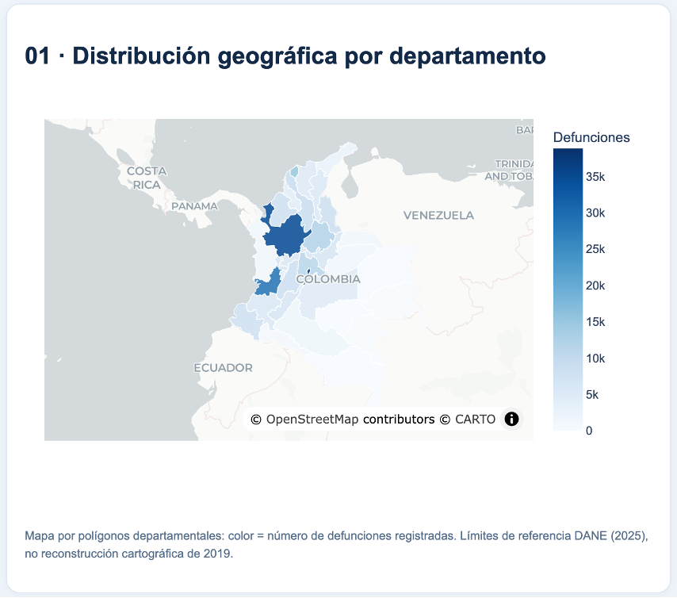
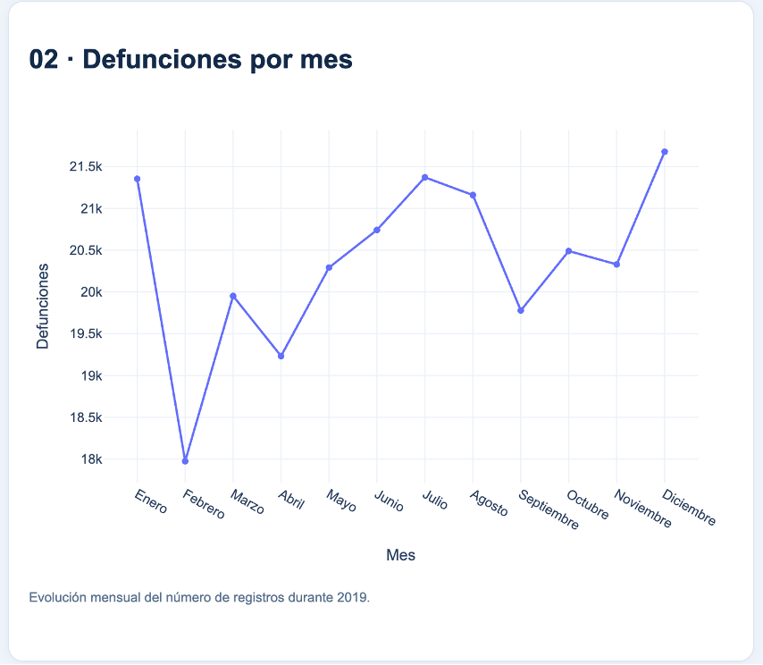
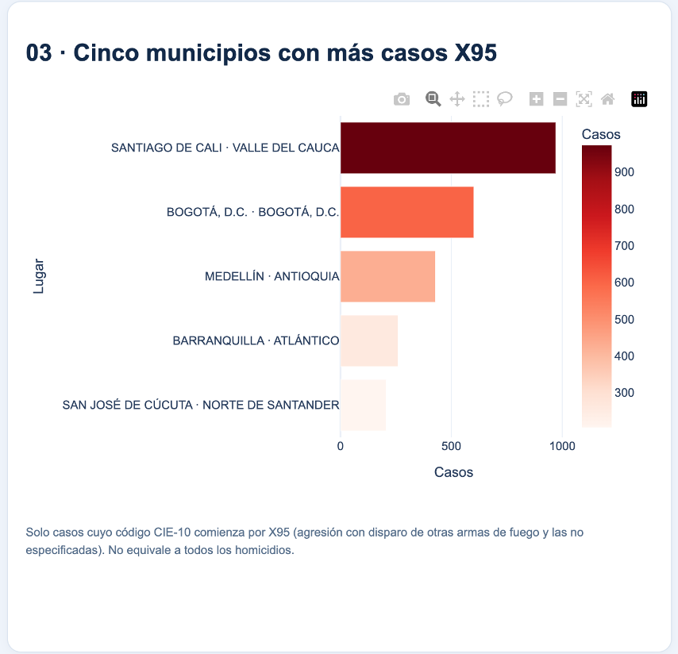
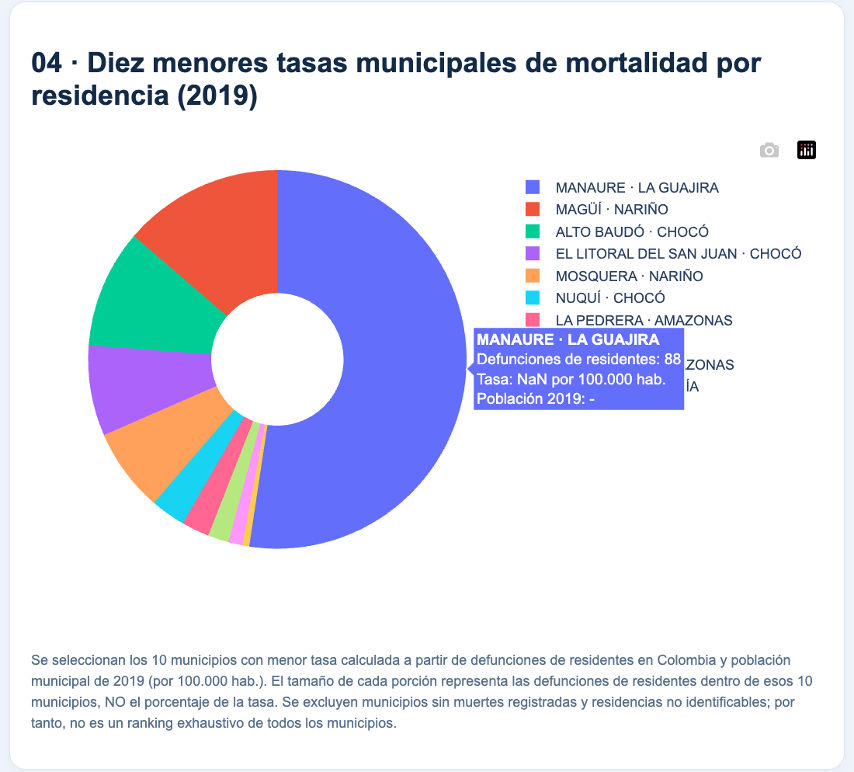
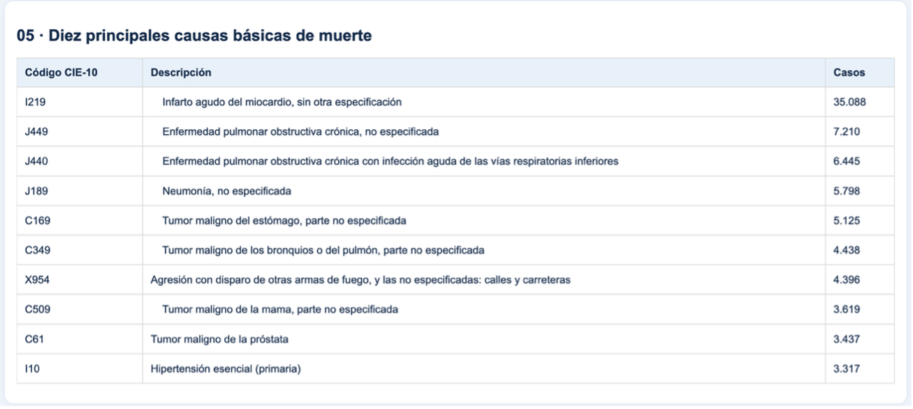
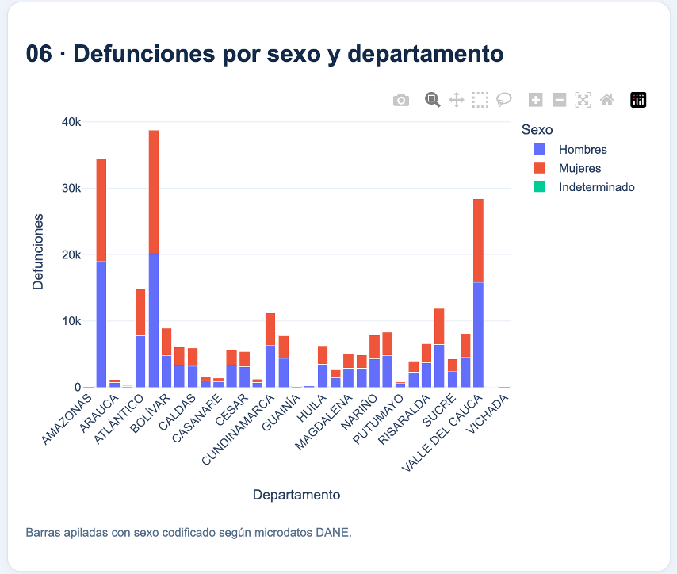
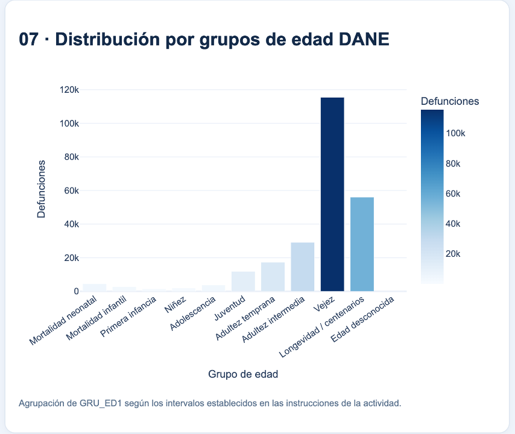

# Actividad 4 · Mortalidad no fetal en Colombia (2019)

**Maestría en Inteligencia Artificial · Aplicaciones I · Universidad de La Salle**  
**Estudiante:** Angely Tatiana Rojas Sandobal  
**Fecha del informe:** 1 de noviembre de 2026

## Aplicación y repositorio

**Dashboard público:** https://mortalidad-colombia-2019-u2ve.onrender.com
**Código fuente:** https://github.com/angely-rojas/Actividad4_Mortalidad_Colombia_2019
**Tecnologías:** Python 3.12, Dash, Plotly, pandas, GitHub y Render.

## Introducción

Esta aplicación web permite explorar registros de **defunciones no fetales en Colombia durante 2019** a través de siete visualizaciones interactivas. El tablero describe diferencias territoriales, evolución mensual, causas básicas de muerte, casos asociados al código CIE-10 X95 y distribuciones por sexo y edad.

El procesamiento utilizado en el ejercicio reúne **244.355 registros** e identifica **33 unidades territoriales**. Las visualizaciones representan información descriptiva: los conteos absolutos no deben interpretarse como tasas de riesgo sin considerar la población correspondiente.

## Objetivo

Desarrollar y publicar una aplicación web interactiva mediante Python, Dash y Plotly que facilite la consulta, comparación e interpretación descriptiva de registros oficiales de mortalidad no fetal de Colombia en 2019.

## Fuentes y preparación de datos

DANE, Estadísticas Vitales 2019: https://microdatos.dane.gov.co/index.php/catalog/696
Clasificación Internacional de Enfermedades (CIE-10), utilizada para interpretar códigos de causas básicas de muerte.
DIVIPOLA, como referencia para códigos y denominaciones municipales y departamentales.
Tabla de población municipal correspondiente a 2019, utilizada como denominador para tasas por residencia habitual.
Cartografía departamental de referencia del DANE (2025); sus límites **no equivalen a una reconstrucción histórica de los límites de 2019**.

Los archivos originales pesados se conservan fuera del repositorio cuando así lo indica `.gitignore`. La aplicación consume los archivos procesados ubicados en `data/`.

## Estructura del proyecto

| Archivo o carpeta | Función |
| --- | --- |
| `main.py` | Aplicación Dash, filtro departamental y siete visualizaciones. |
| `prepare_data.py` | Lectura, limpieza y preparación de los registros de mortalidad. |
| `descargar_mapa.py` | Descarga y preparación de cartografía de referencia. |
| `assets/style.css` | Diseño y estilos de la interfaz. |
| `data/mortalidad_2019_procesado.csv` | Registros procesados utilizados por la aplicación. |
| `data/poblacion_municipal_2019_DANE.csv` | Población municipal de 2019 para el cálculo de tasas. |
| `data/departamentos_referencia.geojson` | Geometrías departamentales utilizadas en el mapa. |
| `requirements.txt` | Dependencias de Python. |
| `render.yaml` | Configuración del despliegue en Render. |
| `.gitignore` | Exclusión de entornos virtuales y archivos originales pesados. |
| `README.md` | Documentación de uso, resultados y despliegue. |

## Requisitos e instalación local (macOS)

Se recomienda **Python 3.12**. Las dependencias concretas y sus versiones se encuentran en `requirements.txt`.

Desde la carpeta raíz del proyecto:

```bash
python3.12 -m venv .venv312
.venv312/bin/python -m pip install -r requirements.txt
.venv312/bin/python main.py
```

Abrir en el navegador: http://127.0.0.1:8050/

Si es necesario reconstruir los archivos procesados y se dispone de los insumos originales correspondientes, ejecutar antes:

```bash
.venv312/bin/python prepare_data.py
```

**Nota:** el paso de preparación puede requerir los archivos originales del DANE, DIVIPOLA y CIE-10, que no necesariamente se incluyen en el repositorio público.

## Visualizaciones y explicación de resultados

### 1. Distribución geográfica por departamento

**Tipo:** mapa coroplético por polígonos departamentales.  
**Lectura:** la intensidad de azul indica la cantidad absoluta de defunciones registradas por departamento. Los tonos más oscuros representan un mayor recuento. El mapa utiliza límites cartográficos de referencia del DANE (2025). No representa tasas por habitante.

### 2. Defunciones por mes

**Tipo:** gráfico de líneas.  
**Lectura:** presenta los registros de enero a diciembre de 2019 y permite identificar fluctuaciones mensuales. La existencia de máximos o mínimos no demuestra por sí sola estacionalidad ni causalidad.

### 3. Cinco municipios con más casos X95

**Tipo:** barras horizontales.  
**Lectura:** clasifica los cinco municipios con más registros de causas cuyos códigos CIE-10 comienzan por **X95**. Este grupo corresponde a una categoría específica de agresión con arma de fuego; no equivale a todos los homicidios ni expresa tasas de violencia.

### 4. Diez menores tasas municipales por residencia habitual

**Tipo:** gráfico circular de dona.  
**Lectura:** los diez municipios se seleccionan mediante la **tasa de defunciones de residentes por 100.000 habitantes**, calculada a partir de defunciones de residentes y población municipal de 2019. El **tamaño de cada porción** muestra el número de defunciones de residentes *dentro de los diez municipios seleccionados*, no el valor de la tasa. La tasa y la población se consultan al pasar el cursor sobre cada municipio.

**Fórmula:** tasa = (defunciones de residentes / población municipal 2019) × 100.000.  
**Ejemplos revisados en el dashboard:** Manaure (La Guajira): 88 defunciones, población 86.496 y tasa aproximada de 101,74 por 100.000; Nuquí (Chocó): 5 defunciones, población 16.733 y tasa aproximada de 29,88 por 100.000. La selección se realiza sobre municipios con datos emparejados y válidos; no es necesariamente un listado exhaustivo de todos los municipios del país.

### 5. Diez principales causas básicas de muerte

**Tipo:** tabla.  
**Lectura:** muestra código CIE-10, descripción y número de casos, en orden descendente. Su utilidad es comparar las causas básicas más frecuentes en el conjunto seleccionado.

### 6. Defunciones según sexo y departamento

**Tipo:** gráfico de barras apiladas.  
**Lectura:** permite comparar la distribución de defunciones por sexo en los departamentos y, al utilizar el filtro, observar la composición del territorio seleccionado. Los valores representan recuentos absolutos.

### 7. Defunciones por grupos de edad

**Tipo:** gráfico de barras por categorías etarias, construidas a partir de los códigos de edad del DANE.  
**Lectura:** resume el número de defunciones en grupos como mortalidad neonatal, infancia, adolescencia, juventud, adultez y vejez. Dado que utiliza categorías de edad agregadas, se describe con precisión como **gráfico de barras**, no como histograma continuo.

### Comportamiento del filtro departamental

La opción **Todos los departamentos** muestra la perspectiva nacional. Al elegir un departamento se actualizan la serie mensual, las causas principales, la distribución por sexo y la distribución por edad. El mapa y los rankings conservan la perspectiva nacional para facilitar la comparación contextual. Volver a **Todos los departamentos** restablece los resultados agregados.

## Evidencias visuales

Las capturas utilizadas en el informe académico corresponden a:

Mapa departamental coroplético.
Serie mensual de defunciones.
Municipios con más registros X95.
Dona de municipios seleccionados por menores tasas de mortalidad.
Tabla de principales causas de muerte.
Gráfico de barras apiladas por sexo y departamento.
Gráfico de barras por grupos de edad.

**Para completar también el README con imágenes**, crear la carpeta `evidencias/` dentro del repositorio y subir las siete capturas, nombradas `figura_1.png` a `figura_7.png`. Luego, bajo cada apartado anterior, insertar su vínculo Markdown, por ejemplo: ``. No se incluyen enlaces a archivos de imagen que aún no estén publicados.

El informe entregado por separado incluye las capturas y sus interpretaciones, además de evidencias complementarias del filtro, del repositorio de GitHub y del estado del servicio en Render.

## Despliegue en Render

El repositorio de GitHub está vinculado al servicio público `mortalidad-colombia-2019` de Render. Los despliegues pueden actualizarse cuando se envían nuevos commits a la rama `main`.

**Instalación:** `pip install -r requirements.txt`
**Inicio:** `gunicorn main:server --workers 1 --threads 2 --timeout 120`
**Aplicación pública:** https://mortalidad-colombia-2019-u2ve.onrender.com

El plan gratuito de Render puede suspender temporalmente una instancia por inactividad y necesitar tiempo para reactivarla.

## Calidad de datos y limitaciones

Se procesaron **244.355 registros** de defunciones no fetales correspondientes a 2019.
En las comprobaciones del procesamiento se reportó un código municipal sin correspondencia exacta en la referencia DIVIPOLA utilizada y dos causas sin descripción exacta en la tabla CIE-10. Estas situaciones deben considerarse al interpretar registros específicos.
El mapa se apoya en cartografía de referencia posterior a 2019.
Los recuentos absolutos de defunciones no son tasas de mortalidad.
Las tasas por residencia habitual dependen del emparejamiento de códigos municipales y de la población utilizada como denominador.
El subconjunto X95 no incluye todas las modalidades de homicidio.

## Referencias

Departamento Administrativo Nacional de Estadística (DANE). Estadísticas Vitales, defunciones no fetales de 2019. https://microdatos.dane.gov.co/index.php/catalog/696
Plotly. Documentación de Dash. https://dash.plotly.com/
Render. Documentación de despliegue. https://render.com/docs
